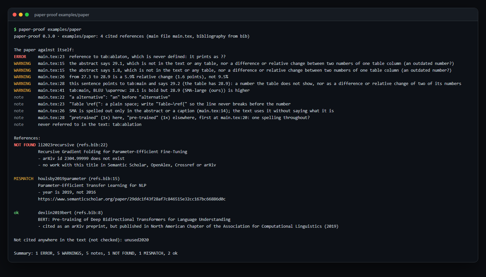

<div align="center">

# paper-proof

**投稿前，先替审稿人把论文查一遍。** 每条参考文献真的存在、信息对得上；加粗的确实是最好的结果；“从 27.3
提升到 28.9，提升 9.5%”算得对；摘要里的数字和表格里的一致；没有哪个 `\ref` 印出来是 **??**。
一条命令查你的 LaTeX 工程、任意一篇 arXiv 论文（给编号即可）或一个 PDF，每个问题都给出文件和行号。

<a href="https://github.com/zch6a/paper-proof/actions/workflows/ci.yml"></a>


<a href="LICENSE"></a>

[English](README.md) · **简体中文**

</div>

---

审稿人最容易抓到的往往是低级错误：引用了一篇根本不存在的论文（AI 写作助手常犯）、年份差一年、加粗的数字并不是那一列最好的、
摘要里还留着上一版实验的结果。paper-proof 抢先把它们找出来。下面是它在[示例论文](examples/paper/main.tex)上的真实输出：

<p align="center"></p>

<details>
<summary>离线运行的同一输出（文字版）</summary>

```text
$ paper-proof examples/paper --offline
paper-proof 0.1.0 · examples/paper: main file main.tex, numbers, labels and citations (references not looked up: offline)

The paper against itself:
ERROR     main.tex:23  reference to tab:ablaton, which is never defined: it prints as ??
WARNING   main.tex:15  the abstract says 29.1, which is not in the text or any table, nor a difference or relative change between two numbers of one table column (an outdated number?)
WARNING   main.tex:15  the abstract says 1.8, which is not in the text or any table, nor a difference or relative change between two numbers of one table column (an outdated number?)
WARNING   main.tex:26  from 27.3 to 28.9 is a 5.9% relative change (1.6 points), not 9.5%
WARNING   main.tex:28  this sentence points to tab:main and says 29.2 (the table has 28.9): a number the table does not show, nor as a difference or relative change of two of its numbers
WARNING   main.tex:41  tab:main, BLEU \uparrow: 28.1 is bold but 28.9 (SMA-large (ours)) is higher
note      never referred to in the text: tab:ablation

Not cited anywhere in the text (not checked): unused2020

Summary: 1 ERROR, 5 WARNINGS, 1 note
```

</details>

## 在著名论文里也能查出问题

在 50 篇知名论文（Transformer、BERT、GPT-3、LoRA、CLIP、Llama 2、DINOv2……）的 arXiv 源码上运行，paper-proof
报出 7 个问题。**我们对照源码逐条核实：7 条全部属实。**

| 论文 | 发现 |
|---|---|
| LoRA（[2106.09685](https://arxiv.org/abs/2106.09685)）GLUE 表 | QQP 列加粗 91.9，同组的 92.1 更高（表题写明越高越好） |
| DINOv2（[2304.07193](https://arxiv.org/abs/2304.07193)）数据消融表 | ADE-20k 加粗 47.7，而 “Uncurated data” 是 48.5 |
| Chinchilla（[2203.15556](https://arxiv.org/abs/2203.15556)）摘要 | 写 MMLU 67.5%，正文和表格都是 67.6% |
| vLLM（[2309.06180](https://arxiv.org/abs/2309.06180)） | `eq:attention-layer` 给两个不同的公式各定义了一次，所有引用只会指向其中一个 |
| LLaVA（[2304.08485](https://arxiv.org/abs/2304.08485)） | `tab:full_example_car_bbox` 在正文和附录各定义一次 |
| LLaVA-1.5（[2310.03744](https://arxiv.org/abs/2310.03744)） | 两张不同的表都叫 `tab:results` |
| BLIP-2（[2301.12597](https://arxiv.org/abs/2301.12597)） | 两张图共用 `fig:example_limitation` |

这些都不影响论文结论，但正是作者自己看不出、读者一眼就看到的那种疏漏，也是工具能在投稿前帮你排除的那种。

## 查什么

**论文自洽**（离线，不发送任何内容）

| | |
|---|---|
| **加粗不是最好** | 一列里（同一组行内）唯一加粗的数字却不是这列最好的。哪边更好看 ↑/↓、指标名（BLEU、准确率、FID、困惑度、错误率、延迟……）或表题（“higher is better”）。模型排在列上的表按行检查 |
| **声称的提升** | “从 A 到 B，提升 p%”和“快 N 倍”：用 A、B 重新算 p 和 N，相对变化和绝对点数都算，允许四舍五入 |
| **摘要数字** | 摘要里的每个小数都应该出现在正文或表格里（允许四舍五入：28.43 → 28.4）；摘要在说“提升了多少”时，也可以是同一列两个数的差或相对变化 |
| **平均值** | “Avg” / “Average” / “Mean” 列应等于同一行前面那些数的平均（全部，或最后几个：表里其他行用的那一组），允许四舍五入。大部分行都对不上的表说明平均另有定义（如加权），不报 |
| **正文与表格** | 指向某张表（`Table~\ref{tab:main}`）的句子里写的数字：应在那张表里，或是表中两个数的差或相对变化。只有表里有一个与它相差 5% 以内的数（过时或打错的结果）时才报，并给出那个数 |
| **标签** | `\ref`、`\cref`、`\autoref` 等指向从未定义的标签（印出来是 ??）；重复定义的标签（有引用时算错误）；从未被提到的图表 |
| **引用** | `\cite` 了但参考文献里没有的条目（印出来是 [?]）；没被引用的条目 |

**每条被引用的文献**（联网：只把标题和标识符发给下面的数据库）

| | |
|---|---|
| **存在** | 先按 DOI（Crossref）和 arXiv 号精确查，再按标题查 Semantic Scholar、OpenAlex、Crossref、arXiv。至少两个应答了的数据库都没有：`NOT FOUND`，并给出最接近的标题 |
| **信息对得上** | 标题、第一作者、其他作者、年份（±1）、DOI 或 arXiv 号是否指向别的论文：`MISMATCH` |
| **已撤稿** | OpenAlex 标记为撤稿：`RETRACTED` |
| **已正式发表** | 引的是 arXiv 预印本，其实已在某会议/期刊发表：给出出处，方便改引正式版 |
| **重复** | DOI、arXiv 号或标题相同的两个条目 |

只查正文真正引用了的：从主文件跟着 `\input`、`\include`、`\subfile` 走，读 `\bibliography` / `\addbibresource`
指向的 `.bib`（或编译出的 `.bbl`、`thebibliography` 环境，任何 BibTeX 样式或 biblatex 都行），忽略注释、
`\iffalse` 块和 `comment` 环境，认得 natbib 和 biblatex 的 `\citep`、`\citet`、`\parencite`、`\textcite`、`\autocite`、`\cites` 等。

## 准确度

用 [`scripts/`](scripts/) 里的脚本，在 [`scripts/papers.txt`](scripts/papers.txt) 列出的 50 篇论文上测量（测量时从 arXiv
取源码，源码不存进本仓库）。

- **误报。** 第一版在这些论文上报了 85 条警告，几乎全是误报。逐条对照源码修规则：并列加粗、每类各自加粗、带 Δ 列的两两对比表、
  对角线加粗（标的是测试设置）、越低越好却加粗最大值、人类/oracle 参考行、放在宏和 `\iftoggle` 分支里的标签。现在：7 条错误和警告，7 条属实（上表）。
- **漏报。** 在同样 50 篇里（内存中）人为注入错误：把正确的加粗挪到更差的格子，**42 处查出 41 处**；把摘要里的数字改成论文里任何地方都没有的值，**11 处查出 9 处**；把指向表格的句子里的数字改动 0.3，**18 处查出 14 处**（漏的 4 处是 0.01 这类很小的值，改动 0.3 已不算“相近”）；把与本行一致的平均值改动 0.5，**6 处查出 6 处**（50 篇里只有 6 张表的平均列是简单平均，样本小）。
- **参考文献。** 在 5 篇论文（Transformer、LoRA、DPO、LLaMA、Mistral）的 264 条参考文献上，第一版报了 23 条“信息不符”，几乎全是误报：
  引用了后来的版本所以年份更晚、复合姓和转写的名字、Crossref 不收录的 arXiv / Zenodo DOI、团体作者。修正后剩 4 条，其中两条是真的错
  （LoRA 把 Jihun Hamm 写成 “Ham”；DPO 引 “Dueling RL” 时第一作者写错）。测试用数据库的真实应答录音驱动（测试从不联网）。
- **PDF。** 同样几篇论文从 PDF 里读出的 372 条参考文献，323 条标题读得一字不差，367 条能匹配上（标题切不准时用整条参考文献去匹配）。

会出错的地方：
- 看不见的约定。加粗表示的不是“最好”、表题也没说明时，会得到一条需要你忽略的警告。一列里有多个加粗、表题解释了加粗含义
  （“not significantly worse”“better than the baseline”）、或者是两两对比表时，paper-proof 不报。
- 读不了的表：画成图片的、由它不展开的宏生成的、或者用了 tabular / tabularx / longtable 以外的宏包。
- 真实存在但四个数据库都没收录的文献（研讨会论文、学位论文、技术报告、书的章节）：会是 `NOT FOUND`，附最接近的标题。
  网页、软件和没有 DOI / arXiv 号的 `@misc` 条目直接跳过，不报。

## 安装

需要 Python 3.10+。用 [uv](https://docs.astral.sh/uv/)：

```bash
uvx --from git+https://github.com/zch6a/paper-proof paper-proof path/to/paper
```

或者安装：`uv tool install git+https://github.com/zch6a/paper-proof`（也可以 `pipx install git+https://github.com/zch6a/paper-proof`）。

## 用法

```bash
paper-proof paper/                 # LaTeX 工程文件夹（自动找主文件），全部检查
paper-proof paper/main.tex         # 指定主文件
paper-proof paper/ --offline       # 只查数字、标签和引用：不发送任何内容
paper-proof 2106.09685             # 任意 arXiv 论文：取它的 LaTeX 源码到临时目录，查完删除
paper-proof paper.pdf              # PDF：查参考文献（PDF 的文字里表格丢了加粗信息）
paper-proof refs.bib               # 只查一个参考文献库
paper-proof paper/ --format json   # 每个问题带文件和行号，给脚本用
paper-proof paper/ --format md     # Markdown 表格，贴进 PR 或审稿意见
```

| 选项 | |
|---|---|
| `--checks refs,numbers` | 查什么（默认两样都查；`--offline` 等于 `--checks numbers`） |
| `--fail-on not-found` | 什么情况下返回 1：`not-found`（默认：编造或撤稿的文献、未定义的引用和标签）、`mismatch`（再加上信息不符和数字警告）、`never` |
| `--only KEY` | 只查这些条目（可重复） |
| `--jobs 4` | 同时查几条；每个数据库仍按自己的节奏 |
| `--no-cache`、`--cache-dir` | 应答缓存 30 天，第二次运行不再请求任何人 |
| `--color auto` | 也可 `always`、`never`；默认只在终端里上色（认 `FORCE_COLOR` 和 `NO_COLOR`） |

退出码：0 没有达到 `--fail-on` 级别的问题，1 发现问题，2 输入读不了。

## 每次推送自动检查（GitHub Action）

论文放在仓库里时（和 GitHub 同步的 Overleaf 项目也行）：

```yaml
name: paper-proof
on: [push, pull_request]
permissions:
  contents: read
jobs:
  proof:
    runs-on: ubuntu-latest
    steps:
      - uses: actions/checkout@3d3c42e5aac5ba805825da76410c181273ba90b1 # v7.0.1
        with:
          persist-credentials: false
      - uses: zch6a/paper-proof@main
        with:
          path: paper          # LaTeX 工程文件夹
          # checks: numbers    # 只做离线检查
          # fail-on: mismatch  # 更严格
```

报告以 Markdown 表格写进任务摘要，JSON 报告是 `report` 输出。这个 action 只需要读权限，不运行你仓库里的任何代码，
并在两次运行之间缓存数据库的应答。

## 在 AI 助手里用（Agent Skill）

[`plugin/skills/paper-proof/SKILL.md`](plugin/skills/paper-proof/SKILL.md) 教 Claude Code 等支持 Agent Skills 的助手什么时候、怎么运行
paper-proof，以及怎么解读结果（“未知”不是错误；关于加粗的警告可能是约定，应当作问题交给作者决定）。从本仓库安装插件，或把这个技能文件夹复制到助手的技能目录。

## 隐私与礼貌

- 数字检查完全离线。参考文献检查只把标题、DOI 和 arXiv 号发给 Crossref、arXiv、Semantic Scholar、OpenAlex，用通用的
  User-Agent，按各服务要求的频率（arXiv 每 3 秒一次），遇到 429 和 5xx 礼貌重试。
- 应答缓存在本地（30 天），改完再跑不会重复请求。
- 可选：`PAPER_PROOF_MAILTO=you@example.org` 给 Crossref 一个联系邮箱（进入它的 “polite pool”）；`OPENALEX_API_KEY` 让 OpenAlex 每日额度提高十倍。都不是必需的，不设就不会发送。
- 不使用 DBLP：它现在对脚本请求返回机器人验证页，paper-proof 不绕过这类验证。

## 许可证

MIT
